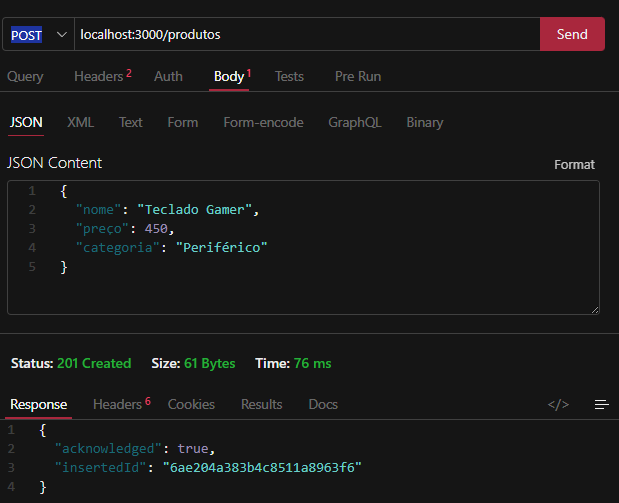
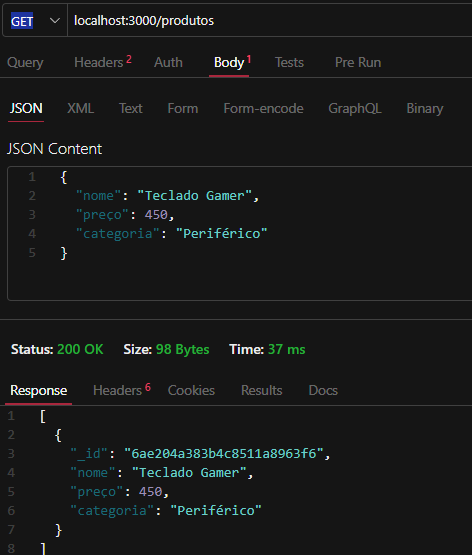
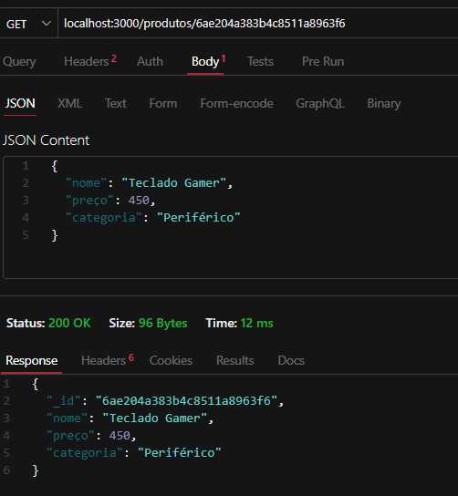
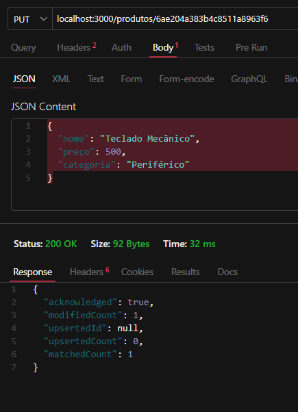
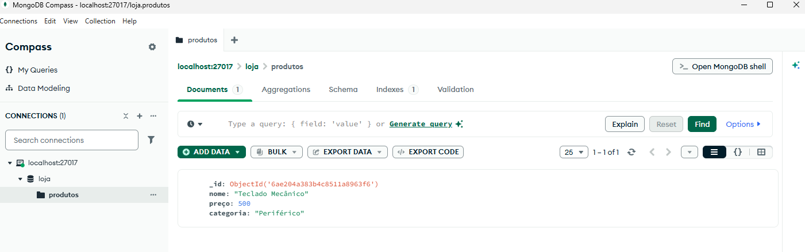

# 🛒 API de Produtos — MongoDB

API desenvolvida para praticar operações CRUD utilizando Node.js, Express e MongoDB. O sistema permite cadastrar, consultar, atualizar e excluir produtos de uma loja.

## 📌 Tecnologias utilizadas

- Node.js
- Express
- MongoDB
- MongoDB Compass
- Thunder Client

## 📂 Estrutura do projeto

```text
api-mongo-bancolocal/
├── prints/
│   ├── 01-post.png
│   ├── 02-get.png
│   ├── 03-get-id.png
│   ├── 04-put.png
│   ├── 05-delete.png
│   └── 06-mongodb.png
├── .env
├── .gitignore
├── index.js
├── package.json
├── package-lock.json
└── README.md
```

- `index.js`: conexão com o banco e rotas da API.
- `.env`: configuração da conexão com o MongoDB.
- `.gitignore`: impede o envio de arquivos desnecessários ou privados.
- `package.json`: configurações e dependências do projeto.
- `prints/`: capturas de tela dos testes.

## ⚙️ Instalação e configuração

### 1. Instalar o Node.js

Baixe pelo site oficial: https://nodejs.org/en/download

Verifique a instalação no terminal:

```powershell
node -v
npm -v
```

### 2. Instalar o MongoDB

Baixe o **MongoDB Community Server**:

https://www.mongodb.com/try/download/community

Execute o instalador para Windows e, se possível, configure o MongoDB como serviço do sistema.

Para visualizar os dados graficamente, instale também o **MongoDB Compass**:

https://www.mongodb.com/try/download/compass

A conexão local padrão do MongoDB utiliza:

```text
mongodb://localhost:27017
```

### 3. Instalar as dependências

Abra a pasta do projeto no VS Code e execute:

```powershell
npm install
```

### 4. Configurar o `.env`

Crie um arquivo `.env` na raiz do projeto com o seguinte conteúdo:

```env
MONGO_URI=mongodb://localhost:27017
```

Essa configuração é para o MongoDB instalado localmente.

### 5. Executar a API

No terminal do VS Code, execute:

```powershell
node --watch --env-file=.env .\index.js
```

Se a conexão funcionar, o terminal deverá mostrar:

```text
Conectado ao MONGODB
API rodando na porta 3000
```

**Endereço da API:** `http://localhost:3000`

## 🔗 Rotas disponíveis

| Método | Endpoint | Função |
|---|---|---|
| `POST` | `/produtos` | Cadastrar produto |
| `GET` | `/produtos` | Listar produtos |
| `GET` | `/produtos/:id` | Consultar produto por ID |
| `PUT` | `/produtos/:id` | Atualizar produto |
| `DELETE` | `/produtos/:id` | Excluir produto |

## 🧪 Testes com Thunder Client

Os testes podem ser realizados pela extensão Thunder Client no VS Code.

Para as requisições `POST` e `PUT`, selecione **Body → JSON**. Nas rotas que utilizam `:id`, substitua pelo identificador real do produto.

### 1. POST — Cadastrar produto

**Método:** `POST`

**URL:** `http://localhost:3000/produtos`

**Body:**

```json
{
  "nome": "Teclado Gamer",
  "preço": 450,
  "categoria": "Periférico"
}
```

**Resultado esperado:** resposta `201 Created` com o resultado da inserção.

**Print do teste:**

!

### 2. GET — Listar produtos

**Método:** `GET`

**URL:** `http://localhost:3000/produtos`

**Resultado esperado:** lista de produtos cadastrados.

**Print do teste:**



### 3. GET — Consultar por ID

**Método:** `GET`

**URL:** `http://localhost:3000/produtos/ID_DO_PRODUTO`

Utilize o `_id` retornado no cadastro.

**Resultado esperado:** dados do produto correspondente.

**Print do teste:**



### 4. PUT — Atualizar produto

**Método:** `PUT`

**URL:** `http://localhost:3000/produtos/ID_DO_PRODUTO`

**Body:**

```json
{
  "nome": "Teclado Mecânico",
  "preço": 500,
  "categoria": "Periférico"
}
```

**Resultado esperado:** confirmação da atualização. Faça um novo `GET` para conferir as alterações.

**Print do teste:**


### 5. DELETE — Excluir produto

**Método:** `DELETE`

**URL:** `http://localhost:3000/produtos/ID_DO_PRODUTO`

Utilize o ID de um produto existente, de preferência um cadastrado especificamente para o teste.

**Resultado esperado:** confirmação da exclusão. O valor `deletedCount: 1` indica que um documento foi excluído.

**Print do teste:**



### 6. Conferir no MongoDB Compass

Abra o banco `loja` e a coleção `produtos` para verificar os documentos cadastrados.

**Print do banco de dados:**



> Os espaços acima são reservados para as capturas reais. Salve os arquivos na pasta `prints/` usando os nomes indicados.

## ⚠️ Observações

- A API utiliza o banco `loja` e a coleção `produtos`.
- A rota `POST` utiliza `insertOne()`, portanto recebe um único objeto JSON por requisição.
- As rotas `PUT` e `DELETE` precisam utilizar corretamente `$set` e `req.params.id` no `index.js`.
- Os testes documentados são manuais; o script padrão de testes do `package.json` ainda não executa testes automatizados.
- Não envie o arquivo `.env` ao GitHub.

O arquivo `.gitignore` deve conter:

```gitignore
node_modules/
.env
```

## 📚 Referências

- [Node.js](https://nodejs.org/en/download)
- [MongoDB Community Server](https://www.mongodb.com/try/download/community)
- [MongoDB Compass](https://www.mongodb.com/try/download/compass)
- [Express](https://expressjs.com/)
- [MongoDB Node.js Driver](https://www.mongodb.com/docs/drivers/node/current/)

## ✅ Conclusão

O projeto permitiu praticar a criação de uma API com Express, a conexão com o MongoDB e as operações CRUD. Os testes ajudam a verificar o funcionamento das rotas e as alterações nos produtos.

**Projeto desenvolvido para fins de estudo de APIs e bancos de dados NoSQL.**
